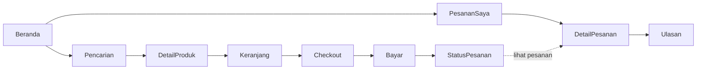

# Flow dan Screen Pembeli Mobile (Katalog sampai Ulasan)

Tiket: PSR-DSG-003. Platform: Android 9+ dan iOS 16+ (KMP + Compose Multiplatform + Navigation3). Token: `docs/token-desain.md`. Requirement TIDAK diduplikasi di sini; rujukan: `produk/10-alur-beli.md`, `produk/30-modul-KMP-bersama.md` §4-§5, kontrak `docs/api/openapi.yaml` di pasaree-backend-service (PR #11, asumsi sampai merge).

## 1. Graf navigasi (Navigation3, dari TownHall §4)



Rute type-safe: `DetailProduk(produkId)`, `Checkout(tripId)`, `Bayar(pesananId)`, `StatusPesanan(pesananId)`, `DetailPesanan(pesananId)`. Deep-link `chefgenie://pasaree/produk/{id}` dan `https://pasaree.chefgenie.id/p/{id}` membuka DetailProduk. Back-stack dipulihkan setelah rotasi dan process-death. Tidak ada layar tayang produk di mobile.

## 2. Katalog layar

Kolom `testTag` = selector Maestro (siklus 2). Semua teks UI Bahasa Indonesia; label konten untuk pembaca layar wajib pada tombol beli, rating, status.

| # | Layar | Tujuan | Data (endpoint) | Komponen kunci | testTag akar |
|---|---|---|---|---|---|
| 1 | Beranda | etalase, kategori, jalan pintas ke PesananSaya | `GET /katalog/produk` (sort `terbaru`/`rating`) | KartuProduk, ChipKategori, BannerLuring | `layar_beranda` |
| 2 | Pencarian | cari + filter kategori/tag + urut | `GET /katalog/produk?q&kategori&tag&sort` (cursor) | KolomCari, ChipFilter, DaftarProduk | `layar_pencarian` |
| 3 | DetailProduk | foto, judul (berat/isi), harga, varian, alergen, lapak, ulasan | `GET /katalog/produk/{id}` | Galeri, HargaProduk, PemilihVarian, LabelAlergen, TombolTambah | `layar_detail_produk` |
| 4 | Keranjang | ubah qty, hapus, kelompok per lapak | `GET/PUT /keranjang` | BarisKeranjang, KelompokLapak, RingkasanSubtotal | `layar_keranjang` |
| 5 | Checkout | pilih trip Lumbung, catatan per lapak, rincian biaya | `GET /trip`, `POST /checkout/pratinjau`, `POST /pesanan` | PemilihTrip, RincianBiaya, TombolBuatPesanan | `layar_checkout` |
| 6 | Bayar | pilih metode, bayar, hitung mundur 30 menit | `POST /pesanan/{id}/bayar` (idempoten) | PemilihMetode (VA_BCA, QRIS, EWALLET_DANA), HitungMundur | `layar_bayar` |
| 7 | StatusPesanan | hasil bayar, timeline langsung | `GET /pesanan/{id}` | LencanaStatus, Timeline | `layar_status_pesanan` |
| 8 | PesananSaya | daftar pesanan, filter aktif/selesai | `GET /pesanan` (cursor) | KartuPesanan, LencanaStatus | `layar_pesanan_saya` |
| 9 | DetailPesanan | sub-pesanan per lapak, timeline, bukti serah trip, aksi | `GET /pesanan/{id}`, `POST .../konfirmasi-terima`, `.../batalkan`, `.../retur` | KelompokSubPesanan, Timeline, TombolAksi | `layar_detail_pesanan` |
| 10 | Ulasan | bintang 1-5, teks, foto | `POST /ulasan` | PemilihBintang, KolomTeks, UnggahFoto | `layar_ulasan` |

### 2.1 Sketsa tata letak (rangka, bukan visual akhir)

```
Beranda               DetailProduk            Checkout
+----------------+   +------------------+   +----------------------+
| Cari produk... |   | [foto geser 1/4] |   | Trip: [Sab 08.00 v]  |
| [Chip kategori]|   | Sambal Bawang 150 g|  | Lapak A  catatan [..]|
| +------+ +----+|   | Rp48.000 ~Rp56.000~|  | Subtotal  Rp96.000   |
| |kartu | |krt ||   | Varian [150 g] [300g]| | Ongkir    Rp10.000   |
| +------+ +----+|   | Alergen: kacang    | | Biaya layanan Rp2.000|
| [Beranda][Pesanan]| | [ + Keranjang ]    | | Total    Rp108.000   |
+----------------+   +------------------+   | [ Buat pesanan ]     |
                                             +----------------------+
```

Aturan tata letak: tombol aksi utama selalu terlihat (bar bawah), target sentuh >= 48 dp, kartu produk memuat foto, judul (maks 2 baris), `HargaProduk`, lencana stok.

## 3. Aturan per layar yang tidak boleh dilanggar

1. **Harga jujur**: seluruh harga lewat `HargaProduk`/`formatIdr()`. Checkout hanya menampilkan Subtotal, Ongkir (per trip), Biaya layanan `Rp2.000`, Total, sesuai `PratinjauCheckout` dari server. Klien TIDAK menghitung total sendiri; komisi lapak TIDAK ditampilkan di mobile.
2. **Stok**: varian stok 0 tidak dapat dimasukkan ke keranjang; tombol berubah "Stok habis". Qty 0-99, melebihi stok = `STOK_HABIS`.
3. **Trip wajib**: Checkout tanpa trip terpilih menonaktifkan "Buat pesanan" (server menolak 422 `trip_id`). Pasaree hanya menampilkan trip hasil `GET /trip`.
4. **Bayar**: batas 30 menit sejak `DIPESAN`; setelah itu pesanan `DIBATALKAN` otomatis (`PESANAN_KEDALUWARSA`). Tombol bayar mengirim `idempotency_key` UUID yang sama pada percobaan ulang; dilarang auto-retry tanpa kunci.
5. **Konfirmasi terima** di DetailPesanan hanya bila `aksi_tersedia` memuat `konfirmasi_terima`; auto-terima 2x24 jam setelah trip tiba (ditampilkan sebagai teks bantu). Retur hanya bila `ajukan_retur` tersedia (non-pangan segar, maks 1x24 jam).
6. **Ulasan**: 1-5 bintang, foto opsional, maks 7 hari setelah selesai, satu per produk per pesanan.
7. **Offline**: bacaan memakai cache (TTL 5 menit); aksi tulis (bayar, konfirmasi) tidak diantrekan diam-diam, tampilkan state luring.

## 4. Status pesanan (visual)

Status dari kontrak (`StatusPesanan`): lencana = teks + ikon + warna (tidak hanya warna).

| Status | Teks | Warna lencana (token) | Catatan |
|---|---|---|---|
| `DRAF_KERANJANG` | Keranjang | `teks_redam` di `permukaan` | tidak tampil di PesananSaya |
| `DIPESAN` | Menunggu pembayaran | `kunyit_teks` di `kunyit_latar_lembut` | tampil hitung mundur 30 menit |
| `DIBAYAR` | Dibayar, menunggu lapak | `pasaree_hijau_daun` di `hijau_latar_lembut` | dana ditahan (escrow) |
| `DIKONFIRMASI_LAPAK` | Disiapkan lapak | `pasaree_hijau_daun` di `hijau_latar_lembut` | |
| `DISERAHKAN_KE_TRIP` | Dalam perjalanan | `pasaree_hijau_daun` di `hijau_latar_lembut` | bukti serah trip tampil |
| `DITERIMA_PEMBELI` | Diterima | `teks_di_hijau` di `pasaree_hijau_daun` | aksi retur/ulasan |
| `SELESAI` | Selesai | `teks_di_hijau` di `pasaree_hijau_daun` | ulasan 7 hari |
| `DIBATALKAN` | Dibatalkan | `pasaree_terakota` di `terakota_latar_lembut` | alasan dan info refund |
| `DIKEMBALIKAN` | Dikembalikan | `pasaree_terakota` di `terakota_latar_lembut` | info refund |

Timeline (DetailPesanan/StatusPesanan) urut waktu dari `timeline[]`; langkah belum tercapai tampil redup (`teks_redam`) dengan teks "Menunggu".

## 5. State error baku

Pola komponen: `StateGalat` = ikon + judul + penjelasan + satu aksi utama (+ aksi sekunder). Pesan dari server tidak ditampilkan mentah; dipetakan di bawah. Warna galat `pasaree_terakota`, ikon wajib (bukan hanya warna).

| Kode / kondisi | Sumber kontrak | Muncul di | Judul | Penjelasan | Aksi |
|---|---|---|---|---|---|
| `STOK_HABIS` | 409 pada `PUT /keranjang`, `POST /checkout/pratinjau` | DetailProduk, Keranjang, Checkout | "Stok tidak cukup" | "Tersisa {stok_tersedia}. Kurangi jumlah atau pilih varian lain." | "Sesuaikan jumlah" (set qty ke stok) / "Hapus item" |
| `HARGA_BERUBAH` | 409, `detail.varian[{varian_id, harga_lama_idr, harga_baru_idr}]` | Checkout | "Harga berubah" | harga lama dicoret, harga baru tampil; total dihitung ulang dari server | "Lihat rincian baru" (tampilkan ulang pratinjau; percobaan berikutnya memakai harga baru) |
| `TRIP_PENUH` | 409 | Checkout | "Trip sudah penuh" | "Pilih jadwal trip lain." | "Pilih trip lain" (buka PemilihTrip, jadwal penuh redup) |
| `AUTH_KEDALUWARSA` | 401 | semua layar yang butuh login | "Sesi berakhir" | "Masuk lagi untuk melanjutkan. Keranjang dan pilihanmu tetap tersimpan." | "Masuk" (coba refresh token dulu, sekali; gagal = layar masuk lalu kembali ke rute asal) |
| Luring | tidak ada jaringan / `sync.status == LURING` | semua | banner "Tidak ada koneksi" | bacaan dari cache; tombol tulis nonaktif | "Coba lagi" (memicu `SyncWorker.now()`) |

State lain yang dipakai bersama (ditambahkan dari kontrak, bukan permintaan tiket): `PRODUK_TIDAK_TERSEDIA` (kartu "Produk tidak lagi tayang", aksi "Hapus dari keranjang"), `PESANAN_KEDALUWARSA` (Bayar: "Waktu bayar habis", aksi "Pesan ulang"), `KONFIRMASI_KEDALUWARSA`/`MASA_RETUR_HABIS`/`TIDAK_DAPAT_DIRETUR` (DetailPesanan, aksi disembunyikan + penjelasan), `ULASAN_SUDAH_ADA`/`ULASAN_KEDALUWARSA` (Ulasan), `LUMBUNG_TIDAK_TERSEDIA` ("Jadwal trip belum bisa dimuat", aksi "Coba lagi"), `BATAS_LAJU` (coba lagi setelah jeda), `KESALAHAN_SERVER` (generik, aksi "Coba lagi").

State kosong: Keranjang kosong ("Keranjangmu masih kosong", aksi "Jelajahi produk"); PesananSaya kosong; Pencarian tanpa hasil (saran ubah kata kunci/filter). State memuat: kerangka (skeleton) kartu, bukan spinner penuh layar.

## 6. Alur uji tampilan (acceptance)

1. Beranda -> DetailProduk -> tambah -> Keranjang -> Checkout -> Bayar -> StatusPesanan memakai data tiruan; setiap layar punya `testTag` akar di atas.
2. Pemicu tiap state error baku dapat ditiru dengan data tiruan (409 `STOK_HABIS`/`HARGA_BERUBAH`/`TRIP_PENUH`, 401, mode pesawat).
3. Total di Checkout sama persis dengan `total_idr` dari pratinjau server.

## 7. Asumsi dan temuan

1. Kontrak diambil dari openapi PR #11 (belum merge); nama field dapat berubah.
2. Metode bayar (`VA_BCA`, `QRIS`, `EWALLET_DANA`) mengikuti openapi, tidak ada di dokumen produk.
3. Hitung mundur 30 menit memakai waktu server (`kunci_stok_hingga`), bukan jam perangkat.
4. Link Figma belum ada (lihat README).
5. `produk/10-alur-beli.md` mencantumkan voucher saat checkout, tetapi tidak ada di openapi; layar Checkout TIDAK memuat voucher sampai kontrak ada.
