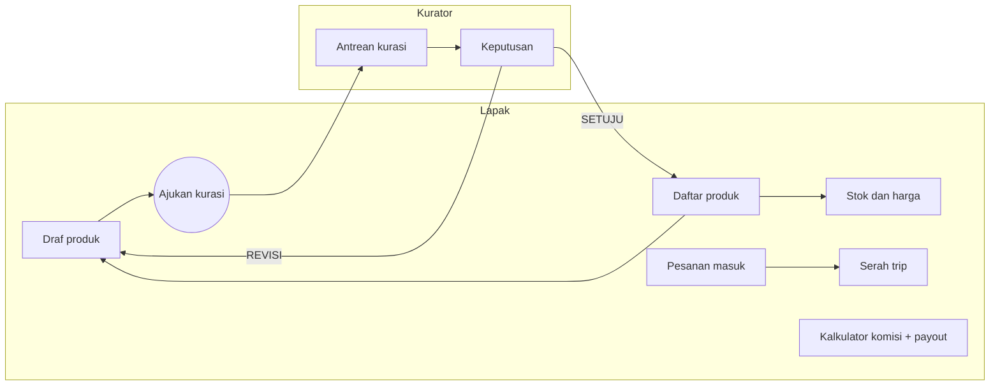

# Flow dan Screen Web Lapak serta Kurasi

Tiket: PSR-DSG-004. Platform: web lapak/admin (Bun + Svelte 5 + SvelteKit 2 + TS), desktop-first, responsif sampai 360 px. Token: `docs/token-desain.md`. Rujukan: `lapak/10-sop-tayang-produk.md`, `produk/21-kontrak-api-web-bun.md`, kontrak `docs/api/openapi.yaml` di pasaree-backend-service (PR #11, asumsi sampai merge). Panduan penilaian kurator: `docs/PANDUAN_KURASI.md` (PSR-DSG-005).

## 1. Peran dan akses (dari SOP §6)

| Peran | Layar yang terlihat |
|---|---|
| Produsen | semua layar lapak; rekening payout |
| Operator lapak | semua layar lapak, tanpa ubah rekening payout |
| Kurator | antrean kurasi, takedown |
| Admin | semua kurasi + komisi, takedown permanen, rekonsiliasi |

Navigasi samping dipangkas menurut peran; layar di luar peran menampilkan state `AKSES_DITOLAK` (403), bukan menu tersembunyi saja.

## 2. Peta layar

| # | Layar | Peran | Tujuan | Endpoint | testid akar |
|---|---|---|---|---|---|
| 1 | Daftar produk | lapak | lihat semua produk + status + catatan revisi | `GET /web/produk?status&lapak_id` | `layar-daftar-produk` |
| 2 | Draf produk | lapak | isi/ubah draf (judul, kategori, tag, deskripsi, komposisi/alergen, varian, foto), cek otomatis, ajukan kurasi | `POST /web/produk/draf`, `PUT /web/produk/{id}`, `POST /web/media/presigned`, `POST /web/produk/{id}/ajukan-kurasi` | `layar-draf-produk` |
| 3 | Stok dan harga | lapak | ubah stok dan harga per varian, riwayat harga | `PATCH /web/varian/{id}/stok`, `PATCH /web/varian/{id}/harga`, `GET /web/varian/{id}/harga-riwayat` | `layar-stok-harga` |
| 4 | Pesanan masuk | lapak | konfirmasi terima/tolak dengan batas waktu | `GET /web/pesanan-masuk`, `POST .../konfirmasi` | `layar-pesanan-masuk` |
| 5 | Serah trip | lapak | serahkan ke trip dengan kode serah | `POST /web/pesanan-masuk/{sub_id}/serah-trip` | `layar-serah-trip` |
| 6 | Antrean kurasi | kurator | antrean FIFO, prioritas pangan segar | `GET /web/kurasi/antrean` | `layar-antrean-kurasi` |
| 7 | Keputusan kurasi | kurator | periksa draf lalu setujui/revisi/tolak | `POST /web/kurasi/{produk_id}/keputusan` | `layar-keputusan-kurasi` |
| 8 | Kalkulator komisi + estimasi payout | lapak | pahami komisi dan payout sebelum/sesudah jual | `GET /web/komisi/tarif`, `GET /web/lapak/{id}/payout` | `layar-kalkulator-komisi` |

Selector Maestro/Playwright memakai atribut `data-testid` (nilai di kolom terakhir).

## 3. Status produk (representasi visual)

Lencana = ikon + teks + warna (tidak hanya warna). Sumber status: `ProdukStatus` openapi dan SOP §5.

| Status | Teks lencana | Warna (token) | Arti dan aksi |
|---|---|---|---|
| `DRAF` | Draf | `teks_redam` di `permukaan`, garis `garis` | disimpan otomatis tiap 10 dtk; aksi: Lengkapi, Ajukan kurasi |
| `MENUNGGU_KURASI` | Menunggu kurasi | `kunyit_teks` di `kunyit_latar_lembut` | tampil estimasi SLA 2x24 jam kerja; draf terkunci, tidak bisa diubah |
| `PERLU_REVISI` | Perlu revisi | `pasaree_terakota` di `terakota_latar_lembut` | catatan kurator (maks 280 karakter) + alasan baku; sisa waktu 7 hari; aksi: Perbaiki |
| `TAYANG` | Tayang | `teks_di_hijau` di `pasaree_hijau_daun` | aksi: Ubah stok/harga, Nonaktifkan via stok 0, Arsipkan |
| `NONAKTIF_STOK_0` | Stok habis | `teks_redam` di `permukaan` + garis putus-putus | otomatis; kembali `TAYANG` saat stok > 0 tanpa kurasi ulang; aksi: Isi stok |
| `TAKEDOWN` | Diturunkan | `teks_di_terakota` di `pasaree_terakota` | alasan + pasal piagam; aksi: Ajukan banding (maks 1x dalam 7 hari) |
| `ARSIP` | Arsip | `teks_redam` di `permukaan` (opak 60%, teks tetap kontras AA) | hanya baca |

Perubahan harga > 20% atau foto utama pada produk `TAYANG` memicu "kurasi ulang ringan"; layar Stok dan harga menampilkan peringatan sebelum simpan: "Perubahan ini akan dikurasi ulang. Produk tetap tayang selama pengecekan." (asumsi perilaku tampil; kontrak hanya menandai `kurasi_ulang_ringan`).

## 4. Aturan layar penting

### 4.1 Draf produk
- Cek otomatis tampil per kolom (422 -> sorot kolom + pesan Indonesia; formulir tidak direset): judul 10-80 karakter dengan berat/isi, harga kelipatan Rp500 dan > 0, stok integer >= 0, foto >= 800x800 dan <= 5 MB, kategori valid, pangan wajib komposisi + alergen + tanggal produksi + kedaluwarsa.
- Diskon wajib harga awal + periode (komponen `HargaProduk`, varian diskon).
- Tombol "Ajukan kurasi" nonaktif selama ada galat cek otomatis; draf `PERLU_REVISI` menampilkan catatan kurator di puncak formulir.

### 4.2 Pesanan masuk dan serah trip
- Kartu sub-pesanan menampilkan: item, `total_idr`, trip yang dipilih pembeli, hitung mundur `batas_konfirmasi_hingga` (2 jam jam kerja 07.00-19.00), `komisi_idr` dan `estimasi_payout_idr` (LabelKomisi, info saja).
- Tolak wajib alasan (mis. `stok_rusak`); dialog konfirmasi menyebut "Pembeli mendapat pengembalian dana penuh. Skor lapak turun bila tanpa alasan sah."
- Serah trip: input `kode_serah` dan pilih trip; galat 422 "Kode tidak cocok atau trip berbeda"; 503 `LUMBUNG_TIDAK_TERSEDIA` -> "Lumbung belum bisa dihubungi, coba lagi" tanpa mengubah status; aksi POST memakai `Idempotency-Key`.
- Semua aksi tulis: optimistic UI + rollback + toast Indonesia (kontrak web §8). `409 STOK_HABIS` pada konfirmasi menampilkan stok terkini + tombol tolak-beralasan.

### 4.3 Antrean dan keputusan kurasi
- Antrean: urut FIFO, baris pangan segar diberi lencana "Prioritas pangan segar" dan di atas; kolom `umur_antrean_jam`; baris > 36 jam kerja ditandai (mendekati SLA 2x24 jam kerja, ambang asumsi). Antrean > 50 item menampilkan banner "Antrean melebihi 50 item, ketua TownHall dinotifikasi" (SOP §4.4).
- Keputusan: tiga tombol Setujui, Revisi, Tolak. Revisi memerlukan `alasan_baku` (pilih dari daftar baku di PANDUAN_KURASI) + catatan <= 280 karakter. Tolak hanya untuk larangan mutlak: wajib tautkan pasal piagam di catatan. Setiap keputusan beraudit (siapa, kapan, alasan, snapshot) ditampilkan sebagai riwayat.
- Panel pemeriksaan di samping: foto (metadata, hasil cek manual), kewajaran harga (selisih terhadap median kategori, batas +-30%), kelengkapan label, daftar periksa dari panduan.

### 4.4 Kalkulator komisi + estimasi payout
Hanya informatif; angka resmi dari server. Komisi dipotong dari payout lapak, BUKAN dari pembeli.

Input: harga produk (integer, kelipatan Rp500), qty, kategori (menentukan 8% atau hampers 10%), apakah lapak masih masa lapak baru 5% (`promo_lapak_baru_hingga`). Keluaran per baris item, `komisi = floor(harga x qty x tarif / 100)`:

| Contoh | Subtotal | Tarif | Komisi | Estimasi payout |
|---|---|---|---|---|
| 1 x Rp56.000 | Rp56.000 | 8% | Rp4.480 | Rp51.520 |
| 1 x Rp56.000 hampers | Rp56.000 | 10% | Rp5.600 | Rp50.400 |
| 1 x Rp56.000 lapak baru | Rp56.000 | 5% | Rp2.800 | Rp53.200 |
| Rp56.000 + 2 x Rp20.000 | Rp96.000 | 8% | Rp7.680 | Rp88.320 |

Ditampilkan juga: jadwal payout "T+1 hari kerja" dan daftar payout (`jenis` PENJUALAN/PENALTI, `status` MENUNGGU/MENGIRIM/DIKIRIM/TERBAYAR/DIBATALKAN, `komisi_idr`, `potongan_idr`, `jumlah_idr`); perubahan tarif terjadwal dari `perubahan_terjadwal` dengan teks "Berlaku mulai {tanggal}, diumumkan 14 hari sebelumnya". Pesanan yang sudah dibayar memakai tarif saat bayar (komisi dibekukan). Teks pendamping wajib: "Komisi dipotong dari payout kamu, bukan dari pembeli. Pembeli membayar harga yang tertera." Dilarang menampilkan komisi seolah biaya tambahan pembeli.

Perhitungan referensi dan contoh tabel diuji di `scripts/komisi.test.mjs`.

## 5. State error web (dari kontrak web §8)

401 -> `/masuk` dengan redirect tersimpan (`AUTH_KEDALUWARSA`); 403 `AKSES_DITOLAK` halaman penjelasan peran; 409 `STATUS_TIDAK_VALID`/`STOK_HABIS` banner di kartu terkait; 422 sorot kolom; 429 `BATAS_LAJU` coba lagi setelah jeda; 503 `LUMBUNG_TIDAK_TERSEDIA`; 500 generik. Mode luring: formulir tetap bisa diisi, aksi simpan/ajukan nonaktif dengan penjelasan.

## 6. Aksesibilitas
Kontras sesuai `docs/token-desain.md`; seluruh lencana punya teks; fokus keyboard terlihat; tabel antrean dan pesanan memakai `<table>` dengan `scope`; target klik >= 40 px.

## 7. Asumsi dan temuan

1. Kontrak dari openapi PR #11 (belum merge). `alasan_baku` di openapi hanya contoh (`FOTO_TIDAK_ASLI`, `HARGA_TIDAK_WAJAR`, `LABEL_KURANG`); daftar lengkap diusulkan di `docs/PANDUAN_KURASI.md` dan perlu disepakati dengan backend.
2. Kontrak web menyebut status filter `DIKONFIRMASI_MENUNGGU` (alias DIBAYAR); layar menampilkan "Menunggu konfirmasi".
3. Ambang tanda "mendekati SLA" (36 jam kerja) adalah asumsi desain.
4. Alur banding takedown (maks 1x, 7 hari, via tiket admin web; SLA 3x24 jam kerja) ada di piagam tetapi belum punya endpoint di openapi; layar hanya menyediakan tombol yang menuju tiket admin (belum ada kontrak).
5. Link Figma belum ada (lihat README).
